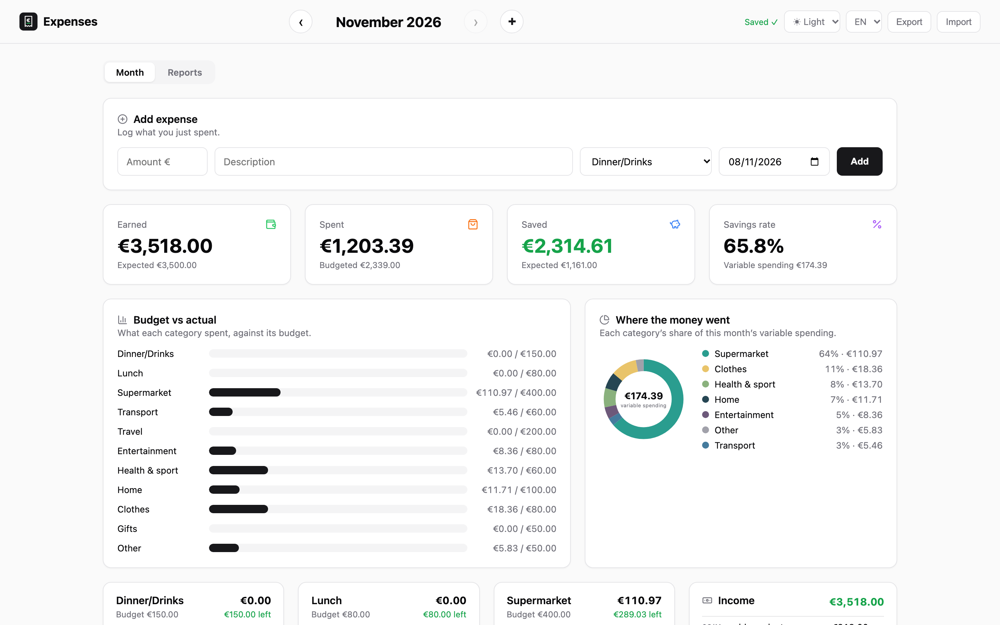
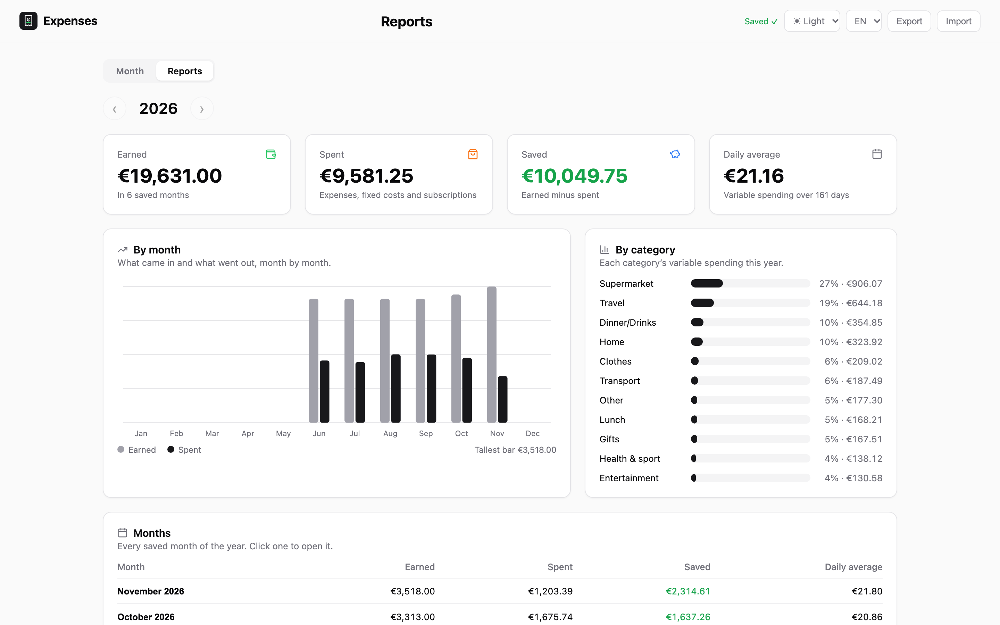
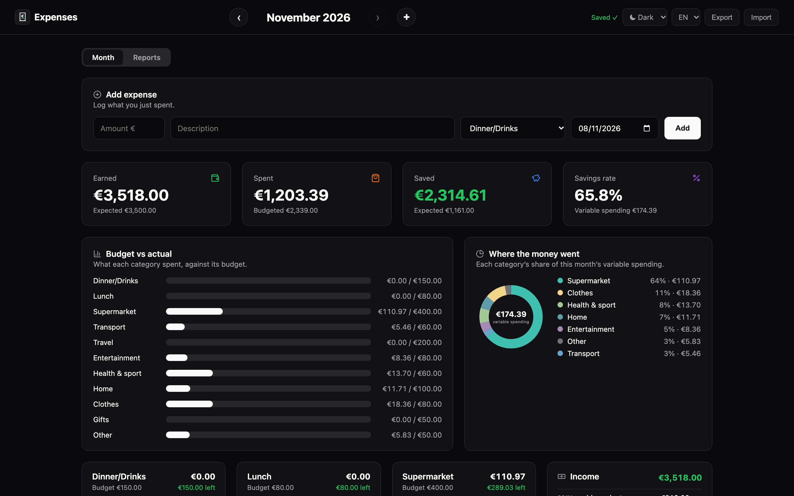
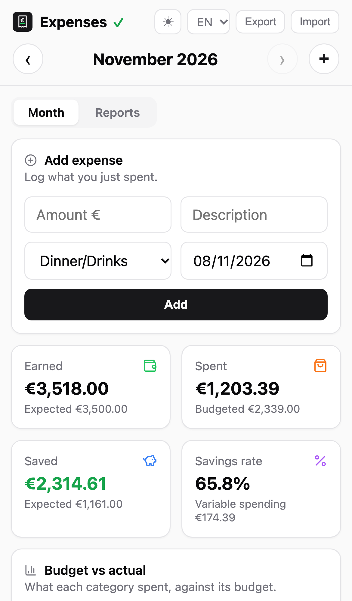

<p align="center">
  
</p>

<h1 align="center">Expenses tracker</h1>

<p align="center">
  <strong>A shared household budget that updates live on every screen.</strong>
</p>

<p align="center">
  Log what you spend by category, set monthly budgets and fixed costs, and see where the
  money went. Everyone in a household sees the same months, and every change appears on
  the others' screens at once, also after editing offline. It runs on Cloudflare's free
  plan, behind a login, in English and Greek, on desktop and as a home-screen app on phones.
</p>

<p align="center">
  <a href="https://github.com/pangiann/expenses-tracker/actions/workflows/check.yml"></a>
  <a href="LICENSE"></a>
  
  
</p>

<p align="center">
  <a href="#features">Features</a> ·
  <a href="#run-the-app-locally">Run locally</a> ·
  <a href="#check-your-changes">Checks</a> ·
  <a href="#deploy-to-cloudflare">Deploy</a> ·
  <a href="#project-layout">Project layout</a> ·
  <a href="#how-data-flows">How data flows</a>
</p>

<p align="center">
  
</p>

## Features

- **Quick add.** Log an expense with an amount, a description, a category and a date.
- **Budgets per category.** Each category card shows what is left; the bars compare spending to budget.
- **Totals at a glance.** Earned, spent, saved and the savings rate for the month.
- **Fixed costs and subscriptions.** Each new month copies them, with the budgets and expected income.
- **Reports.** A year in totals: spending by month, by category, and a table of months.
- **Shared and live.** A household shares its months, and edits reach every open screen over a WebSocket.
- **Works offline.** Edits wait in the browser and go out in order when the connection is back.
- **Undo, export and import.** Undo a removal for a few seconds; back up every month as one JSON file.
- **Light and dark, English and Greek.** On desktop, and full-screen on a phone's home screen.

| Reports                                                                                                            | Dark                                                                          | Phone                                                                                    |
| ------------------------------------------------------------------------------------------------------------------ | ----------------------------------------------------------------------------- | ---------------------------------------------------------------------------------------- |
|  |  |  |

The screenshots show made-up data from `npm run seed`.

## Run the app locally

This section shows you how to run the app on your computer with made-up data, so you can try a change before you push it. The local app keeps its own storage and never touches the live site.

### Prerequisites

Before you begin, install Node.js 22 or later. If you use [mise](https://mise.jdx.dev), run `mise install` in this folder to get the Node.js version in `mise.toml`.

### To run the app locally

1. Install the dependencies:

   ```
   npm install
   ```

2. Copy the local settings file. It lets you skip the login on localhost only, and git ignores it:

   ```
   cp .dev.vars.example .dev.vars
   ```

3. Start the app:

   ```
   npm run dev
   ```

   This runs the real Worker and Durable Object on your computer. Their storage is in `.wrangler/`, which git ignores.

4. Open [http://localhost:8787](http://localhost:8787). The page shows the current month.

5. In a second terminal, fill the last six months with made-up expenses, income and fixed costs:

   ```
   npm run seed
   ```

   The output looks like the following:

   ```
   Imported 6 months (2026-06 to 2026-11). Reload http://localhost:8787
   ```

6. Reload the page. The months now have data.

When you save a file in `web/scripts/`, `wrangler dev` rebuilds the page. Reload the browser to see the change. Run `npm run seed` again whenever you want fresh data; it replaces those six months.

If the page says that it can't read your sign-in, check that `.dev.vars` exists, then stop and restart `npm run dev`.

## Check your changes

Run every check before you push. CI runs the same checks on every push to `main` and every pull request.

### To run every check

1. Run the format, lint and type checks and the unit tests:

   ```
   npm run check
   ```

   The last lines show the unit test count, such as `Tests  97 passed (97)`.

2. Run the integration tests. They take a few seconds:

   ```
   npm run test:integration
   ```

3. The first time only, download the browsers for the UI tests. They take about 300 MB, in `~/Library/Caches/ms-playwright` on a Mac:

   ```
   npm run browsers --workspace tests/ui
   ```

4. Run the UI tests. They take about 40 seconds:

   ```
   npm run test:ui
   ```

If the format check fails, run `npm run format` to fix the layout, then run `npm run check` again. If a UI test fails, it leaves a trace in `tests/ui/test-results/`. Open the trace with `npx playwright show-trace`.

### What each check does

| Command                    | What it checks                                                                                   |
| -------------------------- | ------------------------------------------------------------------------------------------------ |
| `npm run format:check`     | The layout, with Prettier. `npm run format` fixes it.                                            |
| `npm run lint`             | Common mistakes, with ESLint.                                                                    |
| `npm run typecheck`        | The TypeScript code of the page, the Worker, the shared code and the tests.                      |
| `npm test`                 | The unit and React component tests, with vitest. `npm run test:watch` reruns them on every save. |
| `npm run test:integration` | Every endpoint and the WebSocket, against the real Worker in workerd.                            |
| `npm run test:ui`          | The page in Chromium, desktop Safari and an iPhone, with Playwright.                             |

`npm run check` runs the first four. The page and the Worker each have a `tsconfig.json`, because one runs in a browser and the other on Cloudflare. Existing `.js` files aren't checked until they become `.ts`.

The integration tests live in `tests/integration/`, their own npm workspace. They start the real Worker and Durable Object in workerd, Cloudflare's runtime, from `wrangler.jsonc`. They call every endpoint and the live-update WebSocket, then check what the household stored: each edit's month and revision, refused edits storing nothing, import, export, the year summary, and who is refused. They need no server, and each test starts from an empty household.

The UI tests live in `tests/ui/`, another npm workspace. Playwright starts its own `wrangler dev` on port 8788, never your `npm run dev` on 8787, with empty storage in `tests/ui/.state`. It sets up two months through the import endpoint, then clicks, types, drags, opens a second device, goes offline, and checks both the screen and what the server saved.

The Worker's Cloudflare types are generated into `worker/worker-configuration.d.ts`, which git ignores. `npm run check` and `npm run typecheck` regenerate it first. After a fresh clone or a change to `wrangler.jsonc`, run `npm run types` once so your editor sees them too.

## Build

The page is React written in TypeScript (`.tsx` files) in `web/scripts/`, and it imports npm packages by name, for example `import { useState } from 'react'`. `npm run build` uses esbuild to bundle it, minified, together with the packages it imports from `node_modules/`, into `web/dist/main.js`, which `index.html` loads. `web/dist/` is generated and git-ignored.

- `npm run build` builds once; `npm run watch` rebuilds on every save while you work on the page.
- `wrangler deploy` and `wrangler dev` run the build first (`build.command` in `wrangler.jsonc`), so Cloudflare builds on every deploy with no dashboard setting.
- To add a library: `npm install --save-exact <package>`, then import it by name.

## Deploy to Cloudflare

This section shows you how to put the app on your own Cloudflare account, behind a login. Cloudflare builds and deploys it from GitHub on every push to `main`.

> [!IMPORTANT]
> Never put emails or other personal settings in this repository. Who can sign in and which household they belong to live in the Cloudflare dashboard only.

### Prerequisites

Before you begin, complete the following:

- Create a free [Cloudflare account](https://dash.cloudflare.com/sign-up).
- Fork this repository, or push your own copy of it to GitHub.

### To deploy the app

1. In the Cloudflare dashboard, go to **Workers & Pages → Create → Import a repository**.
2. Choose this repository. Keep the default deploy command, `npx wrangler deploy`, and wait for the first deploy to finish.
3. Open the Worker's **Access** tab, or go to **Settings → Domains & Routes → Enable Cloudflare Access**.
4. Choose **All traffic**. For the policy, choose **Cloudflare account**, so only you can sign in at first.
5. In the Worker, go to **Settings → Variables and Secrets** and click **Add**.
6. Choose type **Secret** and add the following, using the email you sign in with:

   | Name                | Value                                                                               |
   | ------------------- | ----------------------------------------------------------------------------------- |
   | `HOUSEHOLD_MEMBERS` | JSON from each email to a household name, for example `{"you@example.com": "home"}` |

7. Open the site. Cloudflare asks you to sign in.
8. Sign in. The page shows the current month.

To bring over months from a backup file, click **Import**.

If the page says that it can't read your sign-in, add the optional secrets `ACCESS_TEAM_DOMAIN` and `ACCESS_AUD` in the same way. The Worker then checks the Access token itself. Normally the Worker learns who signed in from Cloudflare Access (`ctx.access`) and refuses any request that Access didn't sign in.

### To add a household

1. In **Zero Trust → Access → Policies**, edit this Worker's policy.
2. Add **Include → Emails** with the new people's addresses. They sign in with a one-time code sent to their email and need no Cloudflare account.
3. In the Worker's `HOUSEHOLD_MEMBERS` secret, add each new email with its household name, for example:

   ```
   {"you@example.com": "home", "a@example.com": "family-2", "b@example.com": "family-2"}
   ```

People with the same household name share months. Different households never see each other's data.

> [!IMPORTANT]
> The Cloudflare account owner can see all data stored in the account, including every household's months.

### Cost

Everything fits in Cloudflare's free plan. The page files are static assets, which are free and unlimited. Opening the page uses 2 of the 100,000 requests allowed per day: one for the WebSocket and one to load the month. Every edit is one HTTP request. Updates sent back to the screens over the WebSocket are free. A keepalive message every 50 seconds adds about 3 requests per hour that a page stays open. A busy day, with two people logging 50 expenses and each keeping the page open for 8 hours, uses about 100 requests.

## Project layout

[ARCHITECTURE.md](ARCHITECTURE.md) explains how the parts fit together and follows one click from the screen to storage and back.

```
shared/                   code that runs in the page and in the Worker (no DOM, no Cloudflare)
  live-update-messages.ts the two messages on the live-update WebSocket, checked with zod
  api/
    endpoints.ts          every HTTP endpoint: method, path, request body; shared by page and Worker
    fields.ts             the shapes of ids, amounts, text and dates in requests
  month/
    categories.ts         default categories and limits
    amounts.ts            rounding and sums
    month-record.ts       one month's data and the rules for changing it
    month-validation.ts   month keys, month shape, which month a new one copies
    year-summary.ts       a year in totals, for the reports page (GET /api/years/:year/summary)
    apply-edit-to-month.ts  what each editing endpoint does to the month; run by the Worker, and by the page for unsaved edits
web/                      the page (HTML, CSS and TypeScript; bundled into web/dist/ by `npm run build`)
  index.html
  i18n/en.json, el.json   display text for every string id
  styles/                 one stylesheet per section of the page
  scripts/
    main.tsx              entry point: loads the translations, draws the month page with React, connects to the server
    pages/
      app.tsx             which page the address asks for: the month page, or the reports at #reports
      month-page.tsx      the month page: lays out every feature with the page's state
      reports-page.tsx    the reports page: a year in totals
      top-bar.tsx         the top bar both pages share
    features/             one folder per part of the page, each a React component that calls its API functions
      categories/         the category cards (category-card.tsx), the grid that drags them (category-cards-grid.tsx, @dnd-kit), "New category"
      quick-add/          the "Add expense" bar
      income/             the Income card
      recurring-costs/    fixed costs and subscriptions
      summary/            the summary cards, budget bars and spending donut
      month-navigation/   the month title, ‹ › and the "Add a month" dialog
      backup/             Export and Import
      language/           the EN / ΕΛ picker
      theme/              the Auto / Light / Dark menu (web/theme-before-paint.js applies it before the page is drawn)
      status/             the save status and the error banner
      undo/               "Expense removed · Undo" for a few seconds after removing an expense
      reports/            the year's totals, spending by month and by category, and a table of months
    components/           pieces several features use: entry rows, editable amounts and texts
    api/                  one function per endpoint, grouped by what they edit; each edit calls monthPageState.recordEdit()
      months-api.ts, expenses-api.ts, income-api.ts, categories-api.ts, recurring-costs-api.ts
      endpoint-http-client.ts    callEndpoint(): one HTTP request to an endpoint of shared/api/endpoints.ts
    sync/                 keeping the page in step with the server
      month-page-state.ts        the page's state (the month shown, save status, errors), recordEdit(), and how it changes
      unsaved-edits-outbox.ts    sends edits in order; keeps them in the browser while offline
      optimistic-month.ts        the month to show: the saved month with the unsaved edits on top
      live-update-connection.ts  the WebSocket that brings other people's edits; replaces a socket that stops answering
      save-status.ts             what the save status says
      refused-edit-message.ts    why the server refused an edit, for the red banner
    i18n/translator.ts    translations by string id (see "Languages" below)
    utils/                money, month-key and id helpers, and the save status values
worker/                   Cloudflare Worker
  worker-entry-point.ts   every request arrives here: routing, sign-in, forwarding to the household's Durable Object
  worker-secrets.d.ts     the secrets the Worker reads
  sign-in/
    signed-in-user-resolver.ts      who is signed in, from Cloudflare Access
    household-membership-lookup.ts  email -> household name, from the HOUSEHOLD_MEMBERS secret
    same-origin-request-check.ts    refuses requests that another website started
  household-durable-object/
    household-durable-object.ts     one per household: endpoint calls go to the router, WebSockets to the connection manager
    api-request-router.ts           request -> endpoint -> checked params and body -> operation -> JSON answer
    operations/                     one function per endpoint, grouped in add-, change-, remove-, read- and backup-operations.ts; operation-registry.ts lists them
    load-edit-save-and-broadcast-month.ts  the four steps of every edit
    operation-context.ts            what every operation receives: the month repository and the live-update connections
    durable-object-month-repository.ts     the household's months in its Durable Object storage
    live-update-connection-manager.ts      which device shows which month, and sending it updates
scripts/seed-dev-data.mjs made-up months for the local test site: npm run seed
test/                     unit and component tests: npm test
tests/integration/        integration tests, an npm workspace: npm run test:integration
tests/ui/                 UI tests with Playwright, an npm workspace: npm run test:ui
```

## How data flows

Adding an expense, from the click to every screen:

1. **Feature.** The quick add bar (`features/quick-add/quick-add.tsx`), or a category card's add form (`features/categories/category-card.tsx`), handles the form's submit event.
2. **API function.** It calls `addExpense()` in `web/scripts/api/expenses-api.ts`, which gives the expense a new id.
3. **Record and send.** It calls `monthPageState.recordEdit()` (`sync/month-page-state.ts`), which puts the edit in the outbox (`sync/unsaved-edits-outbox.ts`). The outbox sends `POST /api/months/2026-11/expenses` with the expense as JSON. Edits go one at a time, in order. Without a connection they wait in the browser, also across a closed tab, and go out when it is back.
4. **On screen at once.** `recordEdit()` then draws the month again: the saved month, the server's last answer, with the unsaved edits applied on top (`sync/optimistic-month.ts`). The expense appears right away, also offline.
5. **Worker.** `worker/worker-entry-point.ts` checks that the request comes from the site's own page and who is signed in, finds their household, and passes the request to that household's Durable Object (`household-durable-object/household-durable-object.ts`).
6. **Router.** `household-durable-object/api-request-router.ts` finds the endpoint in `shared/api/endpoints.ts`, checks the path and the body against it, and calls the operation with the same name, `addExpenseOperation` in `operations/add-operations.ts`.
7. **Operation.** It runs `loadEditSaveAndBroadcastMonth()`: load the month from storage (`durable-object-month-repository.ts`), apply the endpoint's edit (`shared/month/apply-edit-to-month.ts`, here `month.addExpense(...)` in `shared/month/month-record.ts`, which enforces the month's rules), save it, and send the new month to every device showing it (`live-update-connection-manager.ts`).
8. **Answer.** The operation's answer, the month after the edit, goes back to the page: the page's state (`sync/month-page-state.ts`) keeps it as the saved month, and React draws the month page (`pages/month-page.tsx`) again. Other devices get the same month over their WebSocket (`sync/live-update-connection.ts`) and draw it too.

Steps 4 and 7 run the same edit function from `shared/month/apply-edit-to-month.ts`, so the page's early version and the server's answer agree. Answers and live updates can arrive in either order, so each carries a revision number, and the page ignores anything older than what it shows. A Durable Object handles one request at a time, so two people editing at once never overwrite each other.

To try an endpoint without the page, call it with curl while `npm run dev` runs. An edit needs the Origin header:

```
curl http://localhost:8787/api/months/2026-11
curl -X POST -H "Origin: http://localhost:8787" -d '{"id":"x1","categoryId":"lunch","amount":4,"date":"2026-11-03"}' http://localhost:8787/api/months/2026-11/expenses
```

## Home-screen app

On a phone, open the site and choose **Add to Home Screen** (Safari: Share button; Chrome: ⋮ menu). The tracker then opens full-screen with its own icon. `web/manifest.webmanifest` describes the app, and its icons are PNGs rendered from `web/assets/app-icon.svg`. After changing the SVG, render them again:

```
cd web/assets && for size in 180 192 512; do rsvg-convert -w $size -h $size app-icon.svg -o app-icon-$size.png; done
```

`rsvg-convert` comes with `brew install librsvg`.

## Languages

The page is in English and Greek; the EN / ΕΛ picker in the top bar switches between them and the choice is remembered. The code contains no display text, only string ids such as `summary.earned`. Each language has one file, `web/i18n/en.json` and `web/i18n/el.json`, that maps every id to its text. Components get their text with `t('summary.earned')`. English is the fallback for a missing translation.

To add or change text, edit both files with the same id. `npm test` fails if the files don't have the same ids, if a placeholder like `{amount}` differs, or if the page uses an id that has no text. To add a language, add its file and an entry in `SUPPORTED_LANGUAGES` in `translator.ts`.

## Data

- **Categories** belong to each month. A new household starts with 11 defaults (Dinner/Drinks, Lunch, Supermarket, Transport, Travel, Entertainment, Health & sport, Home, Clothes, Gifts, Other), which show in the page language.
  - **Add** one with the "New category" card at the end of the grid. Names are at most 20 characters and must differ from the month's other names, ignoring capitals.
  - **Rename** one by clicking its name. A renamed default shows the typed name in every language.
  - **Remove** one with the ✕ in its top-right corner, after a confirmation. The ✕ is greyed out, with the reason on hover or tap, while the category has expenses or is the last one.
  - **Reorder** by dragging a card by its header. On a phone, hold the card for a moment first.
  - Every change applies to the month on screen only. A month created later copies the latest earlier month's categories, budgets and order; existing months don't change.
- **Income** is a list of entries, like expenses: a salary, each private lesson, and so on. Earned is their total.
- Every item (expense, income entry, fixed cost, subscription) has an id. Changes name items by id, so two people editing different items never affect each other.
- On start, the app opens the current month and creates it if it doesn't exist.
- A new month copies the budgets, expected income, fixed costs and subscriptions from the closest earlier month. If no month exists yet, it starts from zero.
- Use **‹ ›** to move between saved months and **+** to add any month.
- **Export** downloads every month as one JSON file; **Import** loads such a file and replaces the months it contains. Import accepts only the current format: backup files exported before November 7, 2026, can contain months in an older format and are refused.
